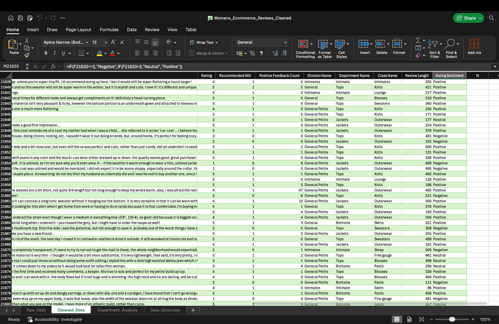
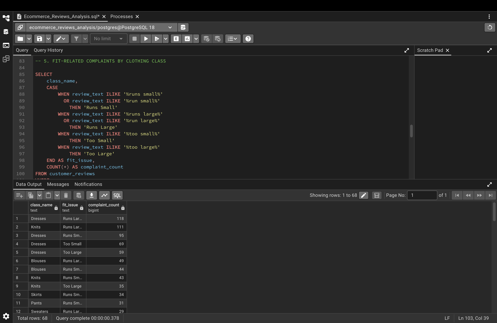
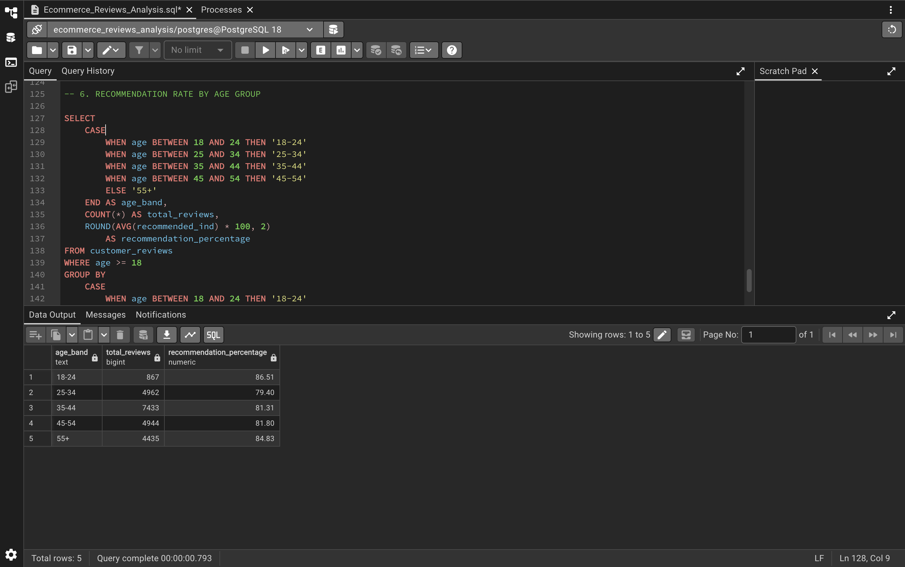
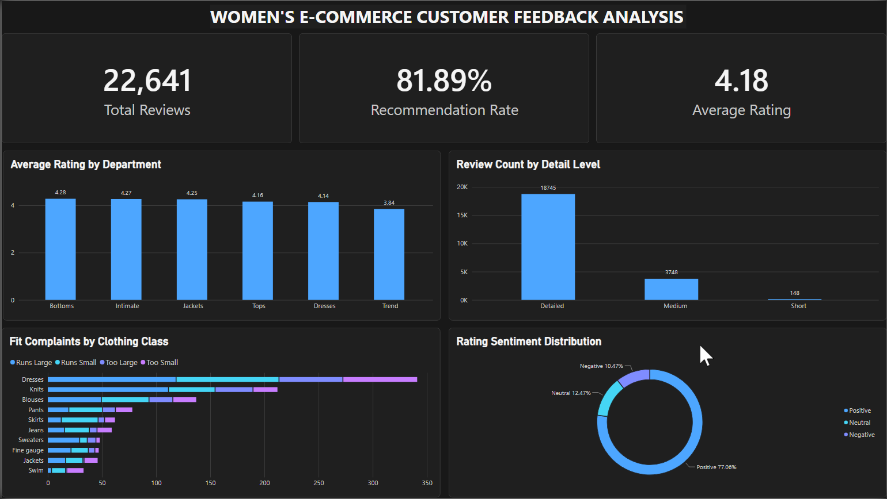

# Women's E-Commerce Customer Feedback Analysis

I wanted to work on a project where I could take a real-world dataset, clean it, explore it, and find something useful in the data rather than just create a few charts.

For this project, I used a Women's E-Commerce Clothing Reviews dataset containing customer reviews, ratings, product categories, age groups, and feedback information.

The main goal was to understand what customers were saying about different clothing products, identify common complaints, and see whether certain patterns appeared in their feedback.

This is an independent portfolio project using a publicly available dataset. It is not based on any company's internal data.

## What I wanted to find out

While exploring the dataset, I focused on a few questions:

- Which clothing departments receive the best and worst ratings?
- Do longer reviews receive more helpful votes?
- Which clothing categories have more fit-related complaints?
- Does the recommendation rate change across different age groups?
- What does the overall rating sentiment look like?

## Tools I used

- **Microsoft Excel** – Cleaning the dataset, adding calculated columns, and creating PivotTables.
- **PostgreSQL** – Checking the data, writing SQL queries, and finding patterns.
- **Power BI** – Building a dashboard to present the results visually.

## Working with the data

The original dataset contained 23,486 records. During the initial review, I found 845 records with missing review text, which I removed from the analysis.

After cleaning, I was left with **22,641 records**.

I also added two columns in Excel:

- `Review Length` – To calculate the number of characters in each review.
- `Rating Sentiment` – To group ratings into Positive (4–5), Neutral (3), and Negative (1–2).

I kept the original data separate from the cleaned data and exported the cleaned version for the SQL and Power BI work.

### A look at the data preparation

## Exploring the data with SQL

Once the cleaned dataset was imported into PostgreSQL, I checked the records and worked through the questions using SQL.

Here are some of the findings.

### 1. Customer ratings by department

| Department | Reviews | Average Rating |
|---|---:|---:|
| Bottoms | 3,662 | 4.28 |
| Intimate | 1,653 | 4.27 |
| Jackets | 1,002 | 4.25 |
| Tops | 10,048 | 4.16 |
| Dresses | 6,145 | 4.14 |
| Trend | 118 | 3.84 |

Bottoms had the highest average rating, while Trend had the lowest. However, Trend had only 118 reviews, so I wouldn't draw a strong conclusion from that result alone.

### 2. Does review length matter?

I grouped reviews into three categories based on their character count:

| Review Type | Number of Reviews | Average Helpful Votes |
|---|---:|---:|
| Short | 148 | 0.90 |
| Medium | 3,748 | 1.27 |
| Detailed | 18,745 | 2.92 |

One interesting pattern was that detailed reviews received more positive feedback votes on average than shorter reviews.

This doesn't necessarily mean that longer reviews are always more useful, but it was an interesting relationship to find in the dataset.

### 3. Looking for fit-related complaints

I searched review text for phrases such as "runs small", "runs large", "too small", and "too large".

A few results stood out:

| Clothing Class | Complaint | Count |
|---|---|---:|
| Dresses | Runs Large | 118 |
| Knits | Runs Large | 111 |
| Dresses | Runs Small | 95 |
| Dresses | Too Small | 69 |
| Dresses | Too Large | 59 |

Dresses appeared frequently in the identified fit complaints. "Runs Large" was also a recurring complaint across different clothing classes.

### 4. Recommendations across age groups

| Age Group | Reviews | Recommendation Rate |
|---|---:|---:|
| 18–24 | 867 | 86.51% |
| 25–34 | 4,962 | 79.40% |
| 35–44 | 7,433 | 81.31% |
| 45–54 | 4,944 | 81.80% |
| 55+ | 4,435 | 84.83% |

The 18–24 group had the highest recommendation rate, while the 25–34 group had the lowest. The 18–24 group also had fewer reviews, which is worth keeping in mind.

### SQL Work Previews

## Building the Power BI dashboard

After the SQL analysis, I moved to Power BI to bring the main findings together in one place.

The dashboard includes three key metrics:

- **Total Reviews:** 22,641
- **Average Rating:** 4.18
- **Recommendation Rate:** 81.89%

It also includes four visualizations:

- Average rating by department
- Review count by review detail
- Fit complaints by clothing class
- Rating sentiment distribution

### Dashboard Preview

## A few things worth keeping in mind

There are some limitations to this analysis:

- The review-length categories are thresholds I chose for this project, not official industry standards.
- Positive feedback count is used as an indication of helpfulness, not a direct measure of review quality.
- Fit complaints were identified using keyword matching, so differently worded complaints may not be captured.
- Sentiment was categorized using star ratings rather than an NLP sentiment analysis model.

## What I learned

This project gave me practical experience working through a complete data analysis workflow.

I got to work with a dataset in Excel, validate and analyze it using PostgreSQL, and then turn the findings into a Power BI dashboard.

More importantly, it helped me understand that analyzing data isn't just about getting numbers or creating visualizations. It's also about asking the right questions, checking whether the results make sense, and being careful about what the data can actually tell us.

**Thanks for taking a look at my project!**